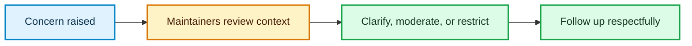

# 🌱 Code of Conduct

  

We want participation in this project to be respectful, constructive, and welcoming to people with different backgrounds and levels of experience.

> [!NOTE]
> These expectations apply to issues, pull requests, code reviews, and other spaces used for this project.

## 💬 How we work together

| We encourage | We do not accept |
| --- | --- |
| Kind, direct, and respectful discussion | Harassment, discrimination, or threats |
| Feedback about ideas and code | Personal attacks or abusive conduct |
| Good-faith questions and constructive reviews | Sexualized conduct or unwelcome attention |
| Respect for privacy and personal boundaries | Publishing another person's private information |

## 🛡️ Enforcement

Project maintainers may edit or remove content and may restrict participation when these expectations are violated. To report a conduct concern, contact the maintainers through the contact details on the [repository owner's GitHub profile](https://github.com/younsabood). Do not publish another person's private information. Use the [security policy](SECURITY.md) only for vulnerability reports.

---

Back to the [project overview](README.md) · See how to [contribute](CONTRIBUTING.md).
