# 🤝 Contributing

<p>
  
  
</p>

Thanks for helping improve TrueSpeech. Bug reports, documentation fixes, and focused code changes are welcome.

> [!TIP]
> Small, focused pull requests are faster to review. For a change to codec behavior or the public API, open an issue first so we can agree on the design.

## 🧭 Contribution path

```mermaid
flowchart LR
    Idea["Idea or bug"] --> Discuss["Issue or discussion"]
    Discuss --> Change["Focused change"]
    Change --> Checks["Run relevant checks"]
    Checks --> PR["Open pull request"]
    PR --> Review["Review and improve"]
    Review --> Merge["Ready to merge"]

    classDef start fill:#cffafe,stroke:#0891b2,color:#083344,stroke-width:2px
    classDef work fill:#ede9fe,stroke:#7c3aed,color:#24134a,stroke-width:2px
    classDef finish fill:#dcfce7,stroke:#16a34a,color:#12351f,stroke-width:2px
    class Idea,Discuss start
    class Change,Checks,PR,Review work
    class Merge finish
```



## 🔎 Before you start

- Search existing issues and pull requests to avoid duplicate work.
- Include steps to reproduce bugs and the smallest useful sample.
- Do not attach credentials, private recordings, or unrelated generated binaries.
- Keep public API changes deliberate and document behavior that callers need to know.

## 🧪 Local checks

Install Rust 1.88 or newer and run the checks relevant to your change:

```powershell
cargo fmt --all --check
cargo check --workspace --all-targets
cargo test --workspace
cargo clippy --workspace --all-targets -- -D warnings
```

For Windows DLL changes, also run `build-release.ps1` on a Windows MSVC toolchain. Describe any check you could not run in the pull request.

## 📦 Pull requests

| Include | Why it helps |
| --- | --- |
| A short summary and motivation | Reviewers can understand the impact quickly. |
| Public API or output changes | Callers can update their integrations safely. |
| Updated examples or docs | New behavior is discoverable and easier to use. |
| Relevant checks and their results | Reviewers can reproduce your validation. |

Keep each pull request focused. Retain third-party notices when changing sourced material, and follow the [MIT License](LICENSE).

---

Back to the [project overview](README.md) · Read the [Code of Conduct](CODE_OF_CONDUCT.md) · Report vulnerabilities using the [security policy](SECURITY.md).
