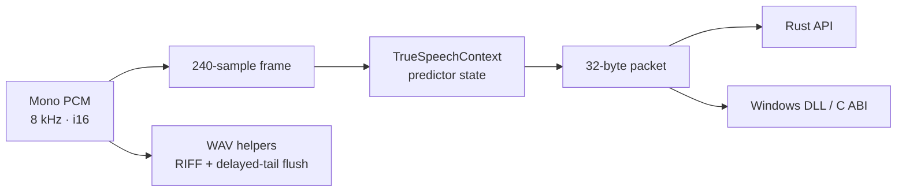

# TrueSpeech Encoder

<div align="center">
<p><strong>A stateful TrueSpeech encoder for Rust and native Windows applications.</strong></p>

<p>
  <a href="https://github.com/younsabood/truespeech"></a>
  
  
  
</p>

<p><code>8 kHz mono PCM</code> &nbsp;→&nbsp; <code>240 samples per frame</code> &nbsp;→&nbsp; <code>32-byte packet</code></p>
</div>

## Start here

| Page | What you will find |
| --- | --- |
| [Quick start](docs/quickstart.md) | Add the crate, encode frames, and write WAV output |
| [API reference](docs/api.md) | Rust functions, outputs, errors, packet layout, and C ABI contracts |
| [Architecture](docs/architecture.md) | Source structure and encoder stages |
| [Windows integration](docs/windows-abi.md) | Build and call the DLL from C or C++ |
| [no_std and WebAssembly](docs/wasm.md) | Build and embed the DSP core in a WASM application |
| [Rendered diagrams](docs/diagrams/README.md) | File map, encoder flow, DLL lifecycle, and function map |

## Open-source project

| Resource | Purpose |
| --- | --- |
| [MIT License](LICENSE) | License terms for this project |
| [Contributing](CONTRIBUTING.md) | How to report issues and submit changes |
| [Code of Conduct](CODE_OF_CONDUCT.md) | Community participation expectations |
| [Security policy](SECURITY.md) | How to report a vulnerability privately |

## What it does

| Capability | Description |
| --- | --- |
| Stateful Rust encoder | Reuse one `TrueSpeechContext` per audio stream to preserve predictor history. |
| Fixed-size packet API | Encode 240 mono `i16` samples into 32 bytes without heap allocation. |
| WAV output | Stream a TrueSpeech RIFF/WAV file or return it as a `Vec<u8>`. |
| Windows C ABI | Use the `TrueSpeech_*` exports with the supplied header and import library. |
| Shared DSP core | Build the same encoder implementation as a separate `no_std` crate. |

The encoder does not decode TrueSpeech or resample audio. Supply mono signed 16-bit PCM at 8 kHz.

## Encoding path



## Quick example

Install directly from the public GitHub repository:

```toml
[dependencies]
truespeech = { git = "https://github.com/younsabood/truespeech" }
```

Encode one frame into caller-owned memory:

```rust
use truespeech::{TrueSpeechContext, TRUESPEECH_FRAME_SAMPLES, TRUESPEECH_PACKET_BYTES};

let pcm = [0_i16; TRUESPEECH_FRAME_SAMPLES];
let mut encoder = TrueSpeechContext::new();
let mut packet = [0_u8; TRUESPEECH_PACKET_BYTES];

encoder.encode_frame(&pcm, &mut packet);
assert_eq!(packet.len(), 32);
```

The [quick start](docs/quickstart.md) covers multi-frame input, buffer sizing, partial frames, and WAV output. The example runner accepts `-h`, `-help`, and `--help`:

```powershell
cargo run --locked --release --example encode_wav -- --help
```

## Build the Windows DLL

With the Rust MSVC toolchain installed, build a distributable x64 folder:

```powershell
.\build-release.ps1
```

The script stages `truespeech.dll`, its MSVC import library, the C header and example, API documentation, build details, and SHA-256 checksums in `dist\windows-x64\`. For C/C++ usage, follow the [Windows integration guide](docs/windows-abi.md).

## Audio format

| Property | Value |
| --- | --- |
| Sample rate | 8,000 samples per second |
| Channels | 1 (mono) |
| PCM input | Signed 16-bit samples |
| Frame duration | 30 ms (240 samples) |
| Packet output | 32 bytes (256 bits) |
| Codec version | `0x01000000` |

## License

This project is licensed under the [MIT License](LICENSE).
