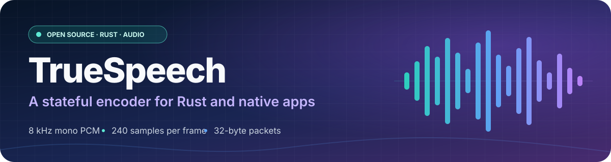
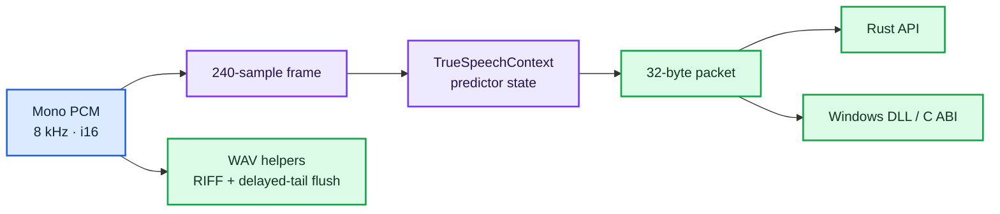

# TrueSpeech Encoder

<p align="center">
  
</p>

<p align="center">
  <a href="https://github.com/younsabood/truespeech"></a>
  
  
  
  <a href="LICENSE"></a>
</p>

<p align="center"><strong>8 kHz mono PCM</strong> &nbsp;→&nbsp; <strong>240-sample frames</strong> &nbsp;→&nbsp; <strong>32-byte packets</strong></p>

> [!IMPORTANT]
> This is an **encoder**. It accepts mono signed 16-bit PCM at 8 kHz and does not decode audio or resample input.

## 🧭 Explore

| Guide | What it covers |
| --- | --- |
| [⚡ Quick start](docs/quickstart.md) | Add the crate, encode frames, size buffers, and write WAV files |
| [📖 API reference](docs/api.md) | Inputs, outputs, errors, packet layout, and C ABI contracts |
| [🏗️ Architecture](docs/architecture.md) | Source responsibilities and the DSP pipeline |
| [🪟 Windows integration](docs/windows-abi.md) | Build and call the DLL from C or C++ |
| [🌐 no_std and WebAssembly](docs/wasm.md) | Build and embed the DSP core in a WASM application |
| [🗺️ Diagrams](docs/diagrams/README.md) | Color-coded encoder, file, function, and DLL diagrams |
| [📚 All documentation](docs/README.md) | Documentation index |

## ✨ Capabilities

| Feature | Details |
| --- | --- |
| Stateful Rust API | Reuse one `TrueSpeechContext` per audio stream to preserve predictor history. |
| Fixed-size frame API | Encode 240 mono `i16` samples into a 32-byte packet without heap allocation. |
| WAV helpers | Stream a TrueSpeech RIFF/WAV file or return it as a `Vec<u8>`. |
| Windows C ABI | Call the `TrueSpeech_*` exports using the supplied header and import library. |
| Shared DSP core | Build the same encoder implementation as a separate `no_std` crate. |

## 🔊 Signal path



## 🚀 Quick example

Add the published crate to your project:

```toml
[dependencies]
truespeech = "1.0.1"
```

Encode one frame into a caller-owned packet buffer:

```rust
use truespeech::{TrueSpeechContext, TRUESPEECH_FRAME_SAMPLES, TRUESPEECH_PACKET_BYTES};

let pcm = [0_i16; TRUESPEECH_FRAME_SAMPLES];
let mut encoder = TrueSpeechContext::new();
let mut packet = [0_u8; TRUESPEECH_PACKET_BYTES];

encoder.encode_frame(&pcm, &mut packet);
assert_eq!(packet.len(), 32);
```

The [quick start](docs/quickstart.md) covers multi-frame input, partial frames, and WAV output. The example runner accepts `-h`, `-help`, and `--help`:

```powershell
cargo run --locked --release --example encode_wav -- --help
```

## 🪟 Build the Windows DLL

With the Rust MSVC toolchain installed, create the x64 distribution:

```powershell
.\build-release.ps1
```

The script stages `truespeech.dll`, its import library, `truespeech.h`, a C example, the full documentation and community guides, the MIT license, build details, and recursive SHA-256 checksums in `dist\windows-x64\`.

## 📡 Audio format

| Property | Value |
| --- | --- |
| Sample rate | 8,000 samples per second |
| Channels | 1 (mono) |
| PCM input | Signed 16-bit samples |
| Frame duration | 30 ms (240 samples) |
| Packet output | 32 bytes (256 bits) |
| Codec version | `0x01000000` |

## 🤝 Community and license

| Resource | Purpose |
| --- | --- |
| [MIT License](LICENSE) | Permissions and conditions for using this project |
| [Contributing](CONTRIBUTING.md) | Local checks and pull request guidance |
| [Code of Conduct](CODE_OF_CONDUCT.md) | Community expectations |
| [Security policy](SECURITY.md) | Private vulnerability reporting |

This project is licensed under the [MIT License](LICENSE).
