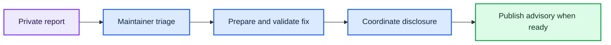

# 🔐 Security Policy

  
  

> [!WARNING]
> Do not post exploit details, private recordings, credentials, or personal data in a public issue.

## 🧩 Supported versions

| Version | Security support |
| --- | --- |
| Latest code on `main` | Primary target for security fixes |
| Published releases | May receive fixes when practical |

## 📬 Report a vulnerability

Use [GitHub's private vulnerability reporting page](https://github.com/younsabood/truespeech/security/advisories/new), if it is enabled for this repository. Include the affected version or commit, the impact, and a minimal reproduction when safe to share.

If private reporting is unavailable, contact the repository maintainer through the contact information on the [GitHub profile](https://github.com/younsabood). Please do not disclose an exploitable issue publicly before a fix is available.

## 🔄 Disclosure flow

---

Back to the [project overview](README.md) · Read the [Code of Conduct](CODE_OF_CONDUCT.md).
