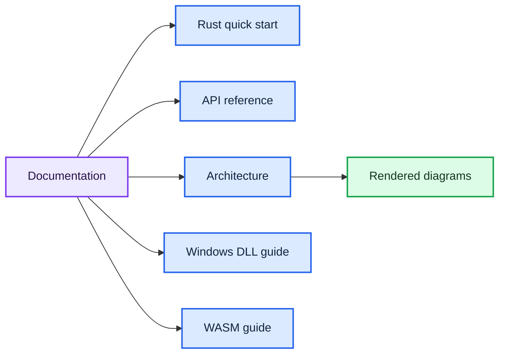

# 📚 TrueSpeech documentation

  
  

Choose a guide by what you want to do. GitHub's **Outline** menu also lets you jump between sections on each page.

## 🧭 Documentation map

| Start with | Page | You will learn |
| --- | --- | --- |
| **Use the Rust API** | [⚡ Quick start](quickstart.md) | Add the crate, encode frames, size buffers, and write WAV output |
| **Understand the API** | [📖 API reference](api.md) | Function inputs, outputs, errors, packet layout, and C ABI contracts |
| **Understand internals** | [🏗️ Architecture](architecture.md) | Source responsibilities, data flow, and DSP stages |
| **Call the Windows DLL** | [🪟 Windows integration](windows-abi.md) | Build the DLL and call it from C or C++ |
| **Target WebAssembly** | [🌐 no_std and WASM](wasm.md) | Build and link the no_std core into an application |
| **See the whole system** | [🗺️ Rendered diagrams](diagrams/README.md) | Color-coded file map, algorithms, lifecycle, and function map |

## 🗺️ Pick a path

## 🤝 Project community

| Resource | Purpose |
| --- | --- |
| [Contributing](../CONTRIBUTING.md) | Local checks and pull request guidance |
| [Code of Conduct](../CODE_OF_CONDUCT.md) | Community expectations |
| [Security policy](../SECURITY.md) | Private vulnerability reporting |
| [MIT License](../LICENSE) | License terms |

Return to the project [README](../README.md) for the feature overview, installation snippet, and Windows build command.
