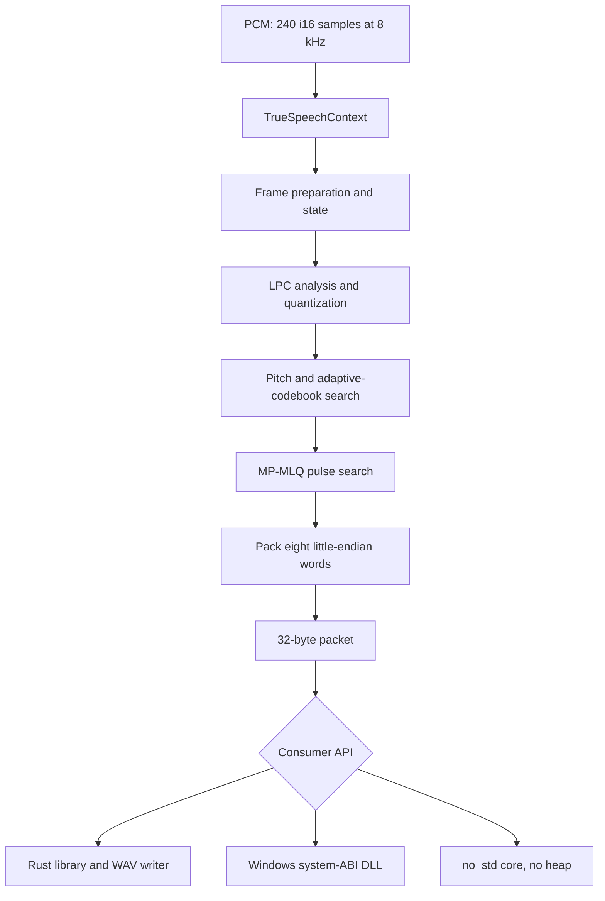

# `truespeech` encoder architecture

This project turns mono PCM into TrueSpeech frames and exposes the same encoder through Rust, a Windows DLL, WAV helpers, and a standalone `no_std` core. Decoding is outside the library's scope.

## Implementation map

## File responsibilities

| Path | Responsibility |
| --- | --- |
| `src/encoder.rs` | The single DSP implementation, lookup tables, `FrameParams`, and `TrueSpeechContext`; the core algorithm does not depend on `std`. |
| `src/lib.rs` | Re-exports the Rust API and provides the legacy DLL ABI wrappers. |
| `src/wav.rs` | Writes RIFF, `fmt`, `fact`, and `data` chunks while encoding PCM. |
| `core/src/lib.rs` | Enables `#![no_std]` and includes the same `encoder.rs` source; there is no second DSP copy. |
| `examples/encode_wav.rs` | Runnable Rust example that creates TrueSpeech WAV output. |
| `examples/use_dll.c` | Native caller example for the Windows DLL. |
| `include/truespeech.h` | C/C++ ABI declarations, constants, buffer sizes, and status behavior. |
| `build-release.ps1` | Builds the Windows DLL and stages a distributable folder. |

The root `Cargo.toml` defines the `truespeech` library as both an `rlib` and `cdylib`. The `core/Cargo.toml` defines the `tsd32-encoder-core` workspace member used for `no_std` and WASM builds.

## Frame analysis

One frame contains 240 samples and is processed as four 60-sample subframes. The encoder calculates and quantizes LPC parameters, analyzes pitch, searches adaptive excitation, then chooses fixed-codebook pulses. `TrueSpeechContext` retains predictor and excitation history between frames, so recreating it for each frame changes the encoded stream.

The final parameters are packed into eight 32-bit words written in little-endian order, producing a 32-byte packet. The code tables and their DSP use sites live together in `encoder.rs`.

## Rust and DLL interfaces

`encode_frame` encodes one frame into a fixed-size caller-owned packet. `encode_samples_into` computes the required output capacity before processing and zero-pads a partial final frame. If capacity is too small, it returns `EncodeBufferError` without modifying the encoder state or output buffer. `write_truespeech_wav` streams the encoded packets into any `Write`; `encode_truespeech_wav` returns a complete in-memory WAV file.

The DLL lifecycle is `TrueSpeech_Init` → repeated `TrueSpeech_Encod` calls → optional `TrueSpeech_Reset` → `TrueSpeech_Term`. The initializer recognizes either PCM-to-TrueSpeech or TrueSpeech-to-PCM descriptor ordering, but the implementation only encodes. Descriptor and return semantics are listed in [api.md](api.md).

## no_std core

`core/src/lib.rs` includes `src/encoder.rs` instead of copying it. This keeps the ordinary Rust library and WASM builds on the same algorithm. The consumer must provide storage and manage buffers outside the DSP core.

## Release outputs

The Windows release script stages the DLL, MSVC import library, C header, C caller example, API reference, build details, and SHA-256 checksums. The standalone core can also be built for targets such as WebAssembly. Generated build and verification files are excluded from the crate package.

Continue with the [quick start](quickstart.md), [API reference](api.md), [Windows guide](windows-abi.md), [WASM guide](wasm.md), or [rendered diagrams](diagrams/README.md).
