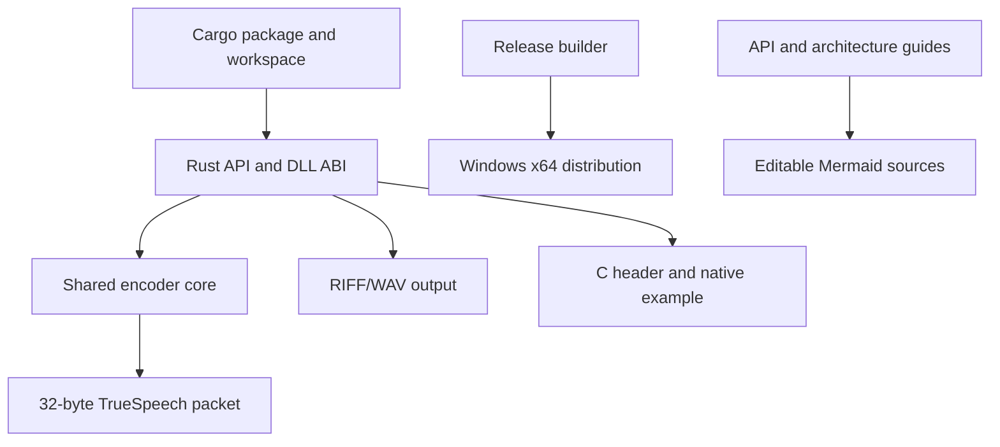
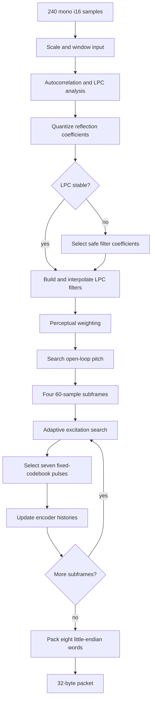
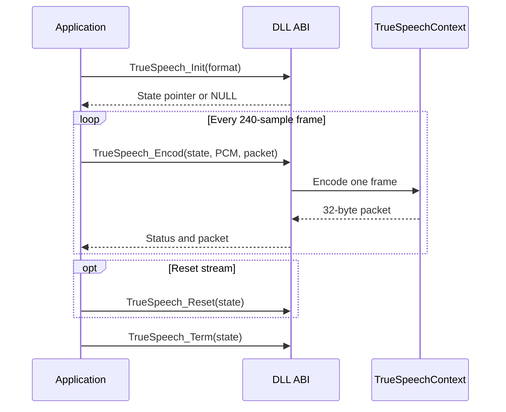
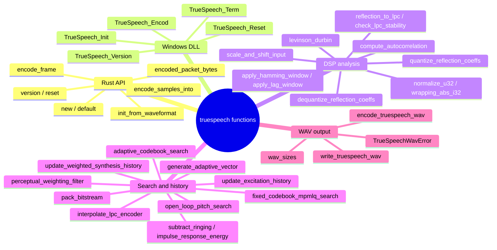

# Diagrams

These diagrams render directly on GitHub. Each one also has an editable Mermaid source (`.mmd`) that was rendered through draw.io.

## Project map

Source: [files-and-apis.mmd](files-and-apis.mmd)

## One-frame encoder algorithm

Source: [encoder-algorithm.mmd](encoder-algorithm.mmd)

## Windows DLL lifecycle

Source: [dll-and-wav.mmd](dll-and-wav.mmd)

## Function map

Source: [function-map.mmd](function-map.mmd)

## Read more

- [Architecture and source responsibilities](../architecture.md)
- [Function inputs and outputs](../api.md)
- [Windows C ABI](../windows-abi.md)
- [Documentation index](../README.md)
