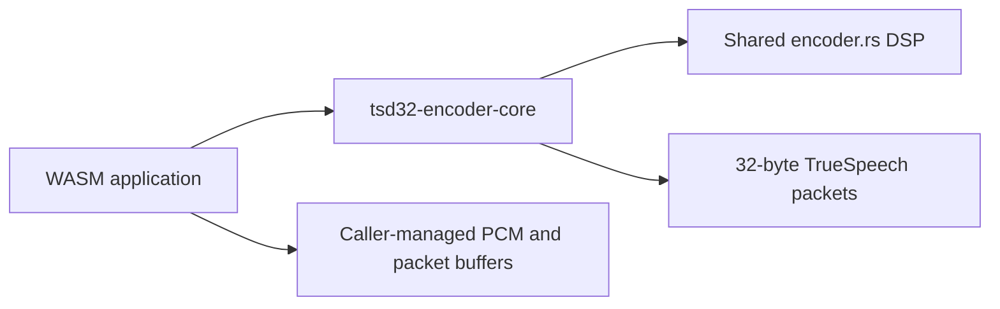

# no_std and WebAssembly

The `tsd32-encoder-core` workspace member wraps the same DSP source used by the main library. It is `no_std`, does not allocate, and exposes the encoder state and packet functions. The core crate is an `rlib`; it is intended to be linked into a WebAssembly application that supplies its own entry points and memory interface.

Install the target and build the core library:

```powershell
rustup target add wasm32-unknown-unknown
cargo build --locked --release --manifest-path core/Cargo.toml --target wasm32-unknown-unknown
```

This command creates a target-specific Rust library artifact. It does not create a standalone `.wasm` module by itself. Link the core from a `cdylib` or application crate to produce a WebAssembly module.



The core module shares the same `TrueSpeechContext` API and format constants as the main package. The WAV writer and Windows C ABI belong to the standard-library wrapper and are not part of the `no_std` core.
