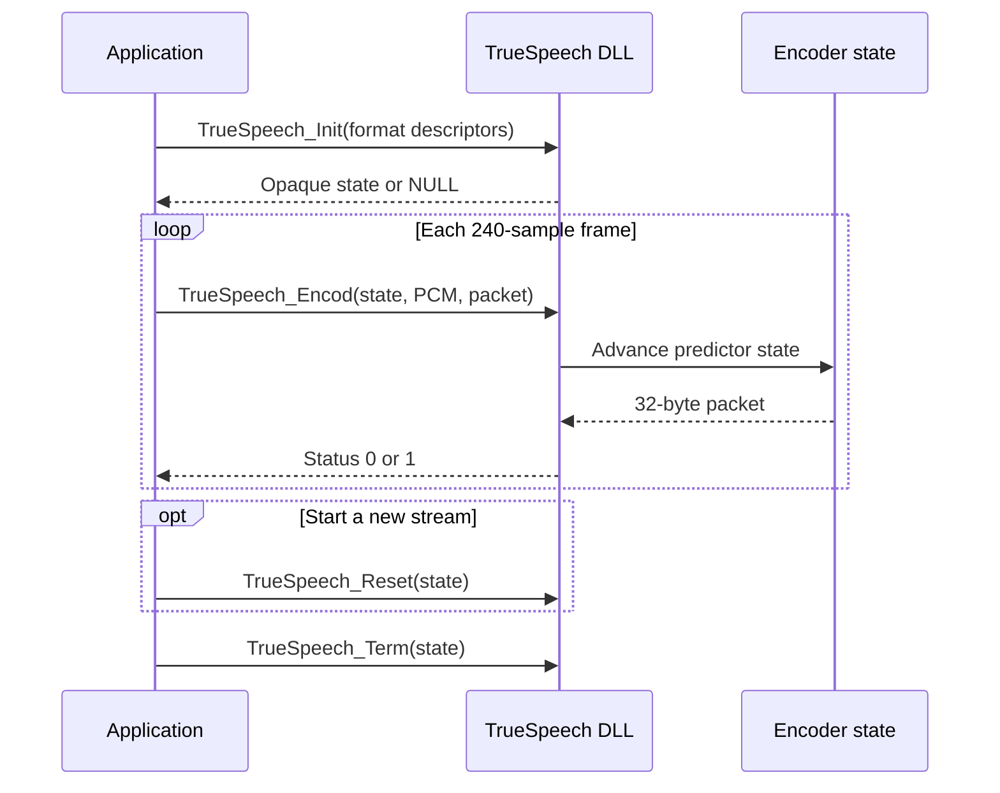

# Windows DLL integration

## Build the distribution

On Windows with the MSVC toolchain installed, run:

```powershell
.\build-release.ps1
```

The x64 distribution is written to `dist\windows-x64\`. It contains `truespeech.dll`, the MSVC import library, `truespeech.h`, a C example, this API reference, build details, and SHA-256 checksums.

Compile the C example with MSVC:

```powershell
cl /I dist\windows-x64 examples\use_dll.c dist\windows-x64\truespeech.dll.lib
```

Keep `truespeech.dll` beside the executable or on `PATH` when running it.

## Encoder lifecycle



## Input and output contract

- Input is mono signed 16-bit PCM at 8 kHz.
- Each `TrueSpeech_Encod` call reads 240 samples (480 bytes) and writes 32 packet bytes into eight writable `uint32_t` words.
- A context belongs to one stream. Do not share it across concurrent callers.
- Input, output, and state memory ranges must not overlap. All pointers must reference valid storage of the documented size.
- `TrueSpeech_Init` returns a state pointer or `NULL`; `TrueSpeech_Encod` and `TrueSpeech_Reset` return `0` on success and `1` for null arguments; `TrueSpeech_Term` releases the state and returns `0`.
- The C ABI does not decode audio, resample input, or validate every PCM format field.

The exact descriptor layout and function signatures are in [`include/truespeech.h`](../include/truespeech.h) and the [API reference](api.md).
